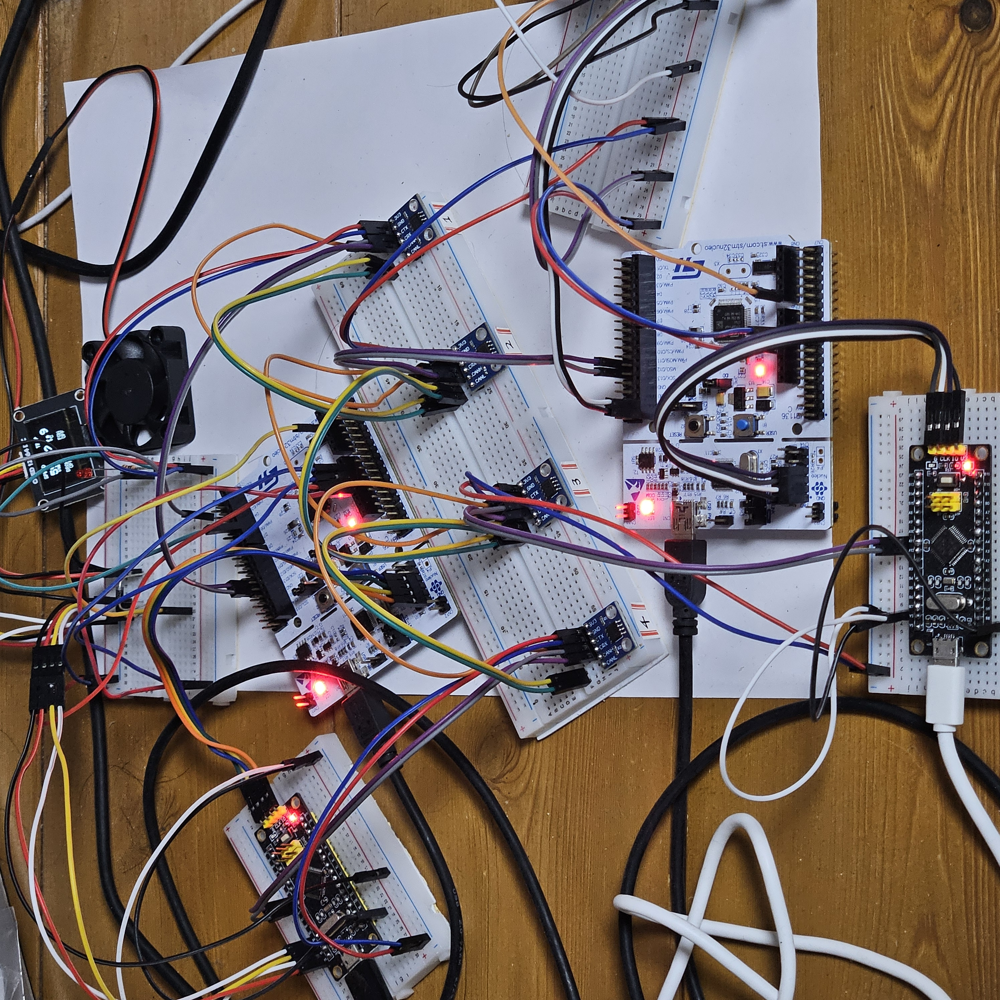
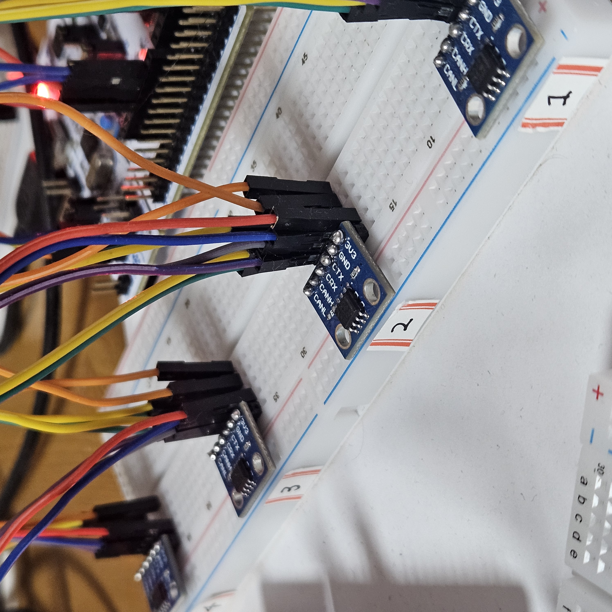
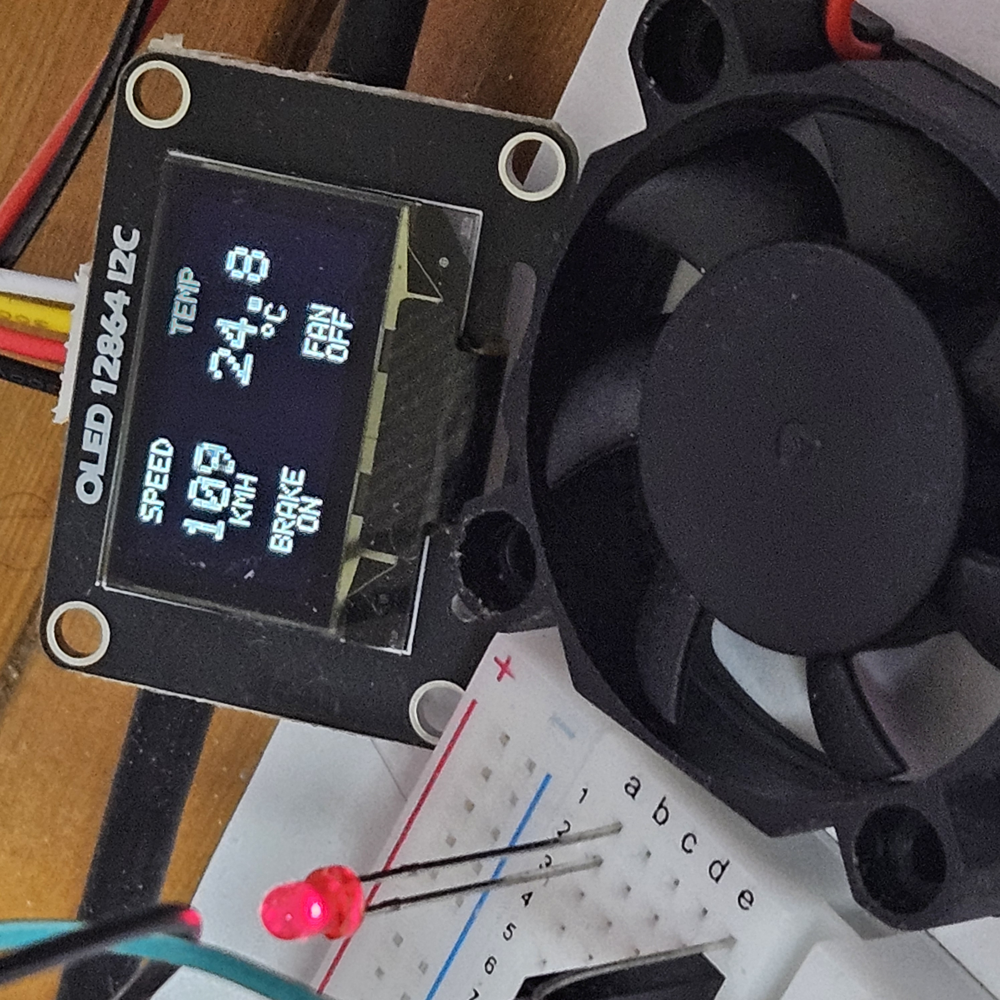

# STM32 Multi-Node CAN Communication System

4개의 STM32 MCU를 활용한 레지스터 기반 CAN 통신 및 분산 제어 시스템

## 1. 프로젝트 개요

4개의 STM32 MCU를 CAN 버스로 연결하여 센서 데이터 수집, 제어 판단, 액추에이터 구동 및 상태 모니터링을 수행하는 다중 노드 통신 시스템입니다.

각 노드는 독립적인 역할을 수행하며, CAN 메시지를 통해 데이터를 공유하고 제어 명령을 전달하도록 설계했습니다.

STM32 HAL 라이브러리에 의존하지 않고 Reference Manual을 기반으로 주변장치 레지스터를 직접 설정하여 CAN 통신 및 하드웨어 제어 기능을 구현했습니다.

### 주요 구현 내용

- **4-Node CAN Network:** 4개의 STM32 MCU를 하나의 CAN 버스로 연결하여 노드 간 통신 구현
- **Register-Level Programming:** Reference Manual을 기반으로 주변장치 레지스터 직접 설정
- **Distributed Control:** 센서 데이터 수집, 제어 판단, 액추에이터 구동, 모니터링 기능을 노드별로 분리
- **CAN Message Filtering:** CAN ID 기반 하드웨어 필터를 설정하여 필요한 메시지만 선택적으로 수신
- **Status Monitoring:** OLED 디스플레이를 통해 센서 데이터 및 액추에이터 동작 상태 표시

## 2. 시스템 구성

본 시스템은 CAN 버스를 공유하는 4개의 노드로 구성됩니다. 각 노드는 서로 다른 기능을 담당하며 CAN 메시지를 통해 데이터를 송수신합니다.

### 2.1 노드별 역할

| Node | MCU | 역할 | 주요 기능 |
|---|---|---|---|
| Node 1 | STM32F446RE | Actuator | 브레이크 LED 및 냉각 팬 제어 |
| Node 2 | STM32F446RE | Sensor | 온도 측정 및 가변저항 기반 차량 속도 모사 |
| Node 3 | STM32F103C8T6 | Controller | 센서 데이터 분석 및 제어 명령 생성 |
| Node 4 | STM32F103C8T6 | Dashboard | OLED를 통한 센서 데이터 및 액추에이터 상태 표시 |

### 2.2 시스템 동작 흐름

**1. Sensor Node (Node 2)**

- SHT20 센서를 통해 온도 데이터를 측정합니다.
- ADC로 가변저항 값을 읽어 차량 속도(0~200 km/h)를 모사합니다.
- 측정한 온도와 속도를 CAN 메시지로 송신합니다.

**2. Controller Node (Node 3)**

- Node 2에서 송신한 온도 및 속도 데이터를 수신합니다.
- 각 데이터를 사전에 설정한 임계값과 비교합니다.
- 임계값에 따라 브레이크 및 냉각 팬 제어 명령을 생성하고 CAN 메시지로 송신합니다.

**3. Actuator Node (Node 1)**

- Node 3에서 송신한 제어 명령을 수신합니다.
- 브레이크 명령에 따라 LED를 ON/OFF 합니다.
- 냉각 팬 명령에 따라 팬을 구동하거나 정지합니다.
- 액추에이터의 동작 상태를 CAN 메시지로 송신합니다.

**4. Dashboard Node (Node 4)**

- CAN 버스에서 센서 데이터와 액추에이터 상태 메시지를 수신합니다.
- 수신한 데이터를 OLED 디스플레이에 표시합니다.
- 차량 속도, 온도, 브레이크 상태 및 냉각 팬 상태를 확인할 수 있습니다.

## 3. 하드웨어 구성

STM32F446RE와 STM32F103C8T6을 각각 2개씩 사용하여 총 4개의 노드로 구성했습니다.

각 MCU는 SN65HVD230 CAN 트랜시버를 통해 공통 CAN 버스에 연결되며, 센서 및 액추에이터 등의 주변장치를 노드별 역할에 맞게 배치했습니다.

### 3.1 사용 하드웨어

| 구분 | 부품 | 수량 | 용도 |
|---|---|---|---|
| MCU | STM32F446RE (NUCLEO-F446RE) | 2 | Node 1, Node 2 |
| MCU | STM32F103C8T6 (Black Pill) | 2 | Node 3, Node 4 |
| CAN Transceiver | SN65HVD230 | 4 | CAN 신호 송수신 |
| 온도 센서 | SHT20 | 1 | 온도 데이터 측정 |
| 가변저항 | Potentiometer | 1 | 차량 속도 모사 |
| 디스플레이 | OLED (SSD1306) | 1 | 센서 데이터 및 액추에이터 상태 표시 |
| 액추에이터 | LED | 1 | 브레이크 동작 상태 표현 |
| 액추에이터 | DC Fan | 1 | 냉각 팬 동작 구현 |
| 구동 회로 | Transistor | 1 | 팬 구동 제어 |
| 종단저항 | 120Ω | 2 | CAN 버스 양 끝단 종단 |

### 3.2 노드별 주변장치 구성

**Node 1 - Actuator (STM32F446RE)**

- GPIO를 이용한 브레이크 LED ON/OFF 제어
- 트랜지스터 구동 회로를 통한 DC Fan ON/OFF 제어
- CAN 트랜시버를 통한 제어 명령 수신 및 동작 상태 송신

**Node 2 - Sensor (STM32F446RE)**

- SHT20 온도 센서와 I2C 통신
- ADC를 이용한 가변저항 입력값 측정
- ADC 값을 0~200 km/h 범위의 차량 속도로 변환
- CAN 트랜시버를 통한 센서 데이터 송신

**Node 3 - Controller (STM32F103C8T6)**

- CAN 트랜시버를 통한 센서 데이터 수신
- 수신 데이터와 설정된 임계값 비교
- 판단 결과에 따른 브레이크 및 팬 제어 명령 송신

**Node 4 - Dashboard (STM32F103C8T6)**

- CAN 트랜시버를 통한 센서 데이터 및 액추에이터 상태 수신
- I2C 기반 SSD1306 OLED 제어
- 차량 속도, 온도, 브레이크 및 팬 상태 표시

### 3.3 CAN 버스 구성

4개의 노드는 SN65HVD230 CAN 트랜시버를 사용하여 하나의 CAN 버스를 공유하도록 구성했습니다.

- **CAN Transceiver:** SN65HVD230
- **CAN 통신 속도:** 500 kbps
- **Transceiver 동작 전압:** 3.3V
- **통신 배선:** CANH, CANL
- **공통 접지:** 모든 노드의 GND 연결
- **종단저항:** CAN 버스 양 끝단에 120Ω 저항 각각 1개 배치

CAN 버스의 양 끝단에만 종단저항을 배치하고, 중간에 연결된 노드에는 종단저항을 적용하지 않도록 구성했습니다.

이를 통해 다중 노드 환경에서 적절한 버스 종단 구성을 유지하도록 했습니다.

### 3.4 주요 GPIO 및 주변장치 연결

| Node | 주변장치 | STM32 핀 | 기능 |
|---|---|---|---|
| Node 1 | Brake LED | PB4 | GPIO Output |
| Node 1 | DC Fan | PB0 | GPIO Output |
| Node 1 | CAN1 | PA11 / PA12 | CAN RX / TX |
| Node 2 | Potentiometer | PA0 | ADC Input |
| Node 2 | SHT20 | PB8 / PB9 | I2C1 SCL / SDA |
| Node 2 | CAN1 | PA11 / PA12 | CAN RX / TX |
| Node 3 | CAN | PA11 / PA12 | CAN RX / TX |
| Node 4 | CAN | PA11 / PA12 | CAN RX / TX |
| Node 4 | OLED | PB6 / PB7 | I2C1 SCL / SDA |

각 노드의 CAN RX/TX는 SN65HVD230 트랜시버에 연결되며, 트랜시버의 CANH/CANL을 통해 공통 CAN 버스에 접속합니다.

## 4. CAN 통신 프로토콜

4개의 STM32 노드 간 데이터 교환을 위해 CAN(Controller Area Network) 통신을 사용합니다.

각 노드는 공통 CAN 버스를 통해 메시지를 송수신하며, CAN ID를 기반으로 메시지의 종류를 구분하고 필요한 데이터를 선택적으로 수신하도록 설계했습니다.

### 4.1 CAN 통신 설정

| 항목 | 설정 |
|---|---|
| CAN Controller | STM32 내장 bxCAN |
| CAN Transceiver | SN65HVD230 |
| CAN Bitrate | 500 kbps |
| Frame Format | Standard Frame (11-bit Identifier) |
| Frame Type | Data Frame |
| Message Payload | 1~2 bytes |
| CAN Filter | Identifier List Mode (32-bit Scale) |
| RX FIFO | FIFO 0 |
| Communication Method | Polling |

Node 1, 3, 4는 Identifier List Mode를 이용해 수신 메시지를 필터링하며, 송신 전용으로 동작하는 Node 2는 수신 필터를 활성화하지 않았습니다.

각 노드는 CAN 메시지 ID에 따라 센서 데이터, 제어 명령, 액추에이터 상태를 구분합니다.

### 4.2 CAN 메시지 ID 설계

CAN 메시지는 기능별로 Control Command, Sensor Data, Actuator Status로 구분했습니다.

| CAN ID | 메시지 | 송신 노드 | DLC | 데이터 형식 |
|---|---|---|---|---|
| `0x100` | Brake Command | Node 3 | 1 | uint8_t |
| `0x110` | Fan Command | Node 3 | 1 | uint8_t |
| `0x200` | Vehicle Speed | Node 2 | 1 | uint8_t |
| `0x210` | Temperature | Node 2 | 2 | int16_t |
| `0x300` | Brake Status | Node 1 | 1 | uint8_t |
| `0x310` | Fan Status | Node 1 | 1 | uint8_t |

#### 데이터 형식

**1. Control Command (0x100, 0x110)**

- 액추에이터 제어 명령을 1바이트로 전송
- `0`: OFF 명령
- `1`: ON 명령

**2. Vehicle Speed (0x200)**

- 가변저항의 ADC 값을 0~200 km/h 범위로 변환
- 1바이트의 부호 없는 정수(uint8_t)로 전송

**3. Temperature (0x210)**

- SHT20 센서에서 측정한 온도를 100배하여 정수로 변환
- 2바이트의 부호 있는 정수(int16_t)로 전송
- 하위 바이트를 DATA0, 상위 바이트를 DATA1에 저장
- 수신 노드에서 100으로 나누어 실제 온도값으로 복원
- 예: 26.00°C → 2600 → 26.00°C

**4. Actuator Status (0x300, 0x310)**

- 브레이크 LED 및 냉각 팬의 동작 상태를 1바이트로 전송
- `0`: OFF
- `1`: ON

### 4.3 노드 간 메시지 흐름

CAN은 브로드캐스트 방식의 통신이므로 송신 노드가 CAN 버스에 메시지를 전송하면 모든 노드가 해당 프레임을 수신할 수 있습니다.

각 노드는 CAN ID와 하드웨어 필터 설정을 통해 필요한 메시지만 처리합니다.

| 송신 노드 | 메시지 | 처리 노드 | 동작 |
|---|---|---|---|
| Node 2 | Vehicle Speed (0x200) | Node 3, Node 4 | 속도 기반 제어 판단 및 화면 표시 |
| Node 2 | Temperature (0x210) | Node 3, Node 4 | 온도 기반 제어 판단 및 화면 표시 |
| Node 3 | Brake Command (0x100) | Node 1 | 브레이크 LED 제어 |
| Node 3 | Fan Command (0x110) | Node 1 | 냉각 팬 제어 |
| Node 1 | Brake Status (0x300) | Node 4 | 브레이크 동작 상태 표시 |
| Node 1 | Fan Status (0x310) | Node 4 | 냉각 팬 동작 상태 표시 |

#### 제어 조건 및 상태 처리

Node 3은 Node 2에서 수신한 속도 및 온도 데이터를 설정된 임계값과 비교하여 브레이크 및 팬 제어 명령을 생성합니다.

| 제어 대상 | 임계값 | 조건 | 제어 명령 |
|---|---|---|---|
| Brake LED | 100 km/h | Speed >= 100 km/h | ON |
| Brake LED | 100 km/h | Speed < 100 km/h | OFF |
| Cooling Fan | 26°C | Temperature >= 26°C | ON |
| Cooling Fan | 26°C | Temperature < 26°C | OFF |

Node 3은 판단 결과에 따라 `0x100` 또는 `0x110` 메시지를 송신합니다. Node 1은 수신한 명령에 따라 액추에이터를 제어하고, 동작 상태를 `0x300` 또는 `0x310` 메시지로 송신합니다.

또한 Node 1은 마지막 정상 브레이크 명령 수신 후 2초 동안 새로운 명령을 수신하지 못하면 브레이크 LED를 OFF하고 해당 상태를 CAN 메시지로 송신하도록 구현했습니다.

### 4.4 CAN 메시지 우선순위

CAN은 여러 노드가 동시에 메시지를 송신하려는 경우, 비트 단위 중재(Bitwise Arbitration)를 통해 버스 사용 우선순위를 결정합니다.

Standard CAN Frame에서는 **11-bit CAN ID의 값이 작을수록 높은 중재 우선순위**를 가집니다.

제어 명령의 중재 우선순위를 센서 데이터 및 상태 메시지보다 높게 설정하도록 CAN ID를 할당했습니다.

| 우선순위 | CAN ID | 메시지 |
|---|---|---|
| 1 | `0x100` | Brake Command |
| 2 | `0x110` | Fan Command |
| 3 | `0x200` | Vehicle Speed |
| 4 | `0x210` | Temperature |
| 5 | `0x300` | Brake Status |
| 6 | `0x310` | Fan Status |

### 4.5 CAN 메시지 필터링

각 노드는 CAN 버스에서 전달되는 모든 메시지를 처리할 필요가 없으므로, CAN 하드웨어 필터를 이용해 필요한 CAN ID를 선택적으로 수신하도록 구성했습니다.

수신 필터는 **32-bit Identifier List Mode**로 설정했으며, 지정된 CAN ID와 일치하는 메시지를 RX FIFO 0에 저장하도록 구현했습니다.

#### 노드별 수신 대상 메시지

| 노드 | 수신 CAN ID | Filter Bank | 수신 목적 |
|---|---|---|---|
| Node 1 | `0x100`, `0x110` | Bank 0 | 브레이크 및 팬 제어 명령 수신 |
| Node 2 | - | 비활성화 | 센서 데이터 송신 전용 |
| Node 3 | `0x200`, `0x210` | Bank 0 | 속도 및 온도 데이터 수신 |
| Node 4 | `0x200`, `0x210`, `0x300`, `0x310` | Bank 0, 1 | 센서 데이터 및 액추에이터 상태 수신 |

32-bit Identifier List Mode에서는 하나의 Filter Bank에 2개의 CAN ID를 등록할 수 있습니다.

Node 1과 Node 3은 각각 2개의 메시지를 수신하므로 Filter Bank 0만 사용했습니다.

Node 4는 총 4개의 메시지를 수신해야 하므로 Filter Bank 0과 Bank 1을 사용했습니다.

필터를 통과한 메시지는 RX FIFO 0에 저장되며, 각 노드는 Polling 방식으로 메시지를 읽고 CAN ID 및 DLC를 확인하여 해당 기능을 수행합니다.

## 5. 주요 구현 내용

본 프로젝트에서는 STM32 HAL 라이브러리를 사용하지 않고, Reference Manual을 기반으로 레지스터를 직접 설정하여 CAN 통신과 주변장치 제어 기능을 구현했습니다.

CAN 초기화, 메시지 송수신, 하드웨어 필터링 및 오류 상태 확인 기능을 직접 구현했으며, 각 노드의 역할에 맞게 제어 로직을 분리했습니다.

### 5.1 CAN 및 GPIO 초기화

STM32F446RE와 STM32F103C8T6은 GPIO 설정 레지스터의 구조가 다르므로, MCU별로 GPIO 초기화 함수를 구현했습니다.

**STM32F446RE (Node 1, 2)**

- `RCC_AHB1ENR`: GPIOA 클럭 활성화
- `GPIOA_MODER`: PA11, PA12를 Alternate Function Mode로 설정
- `GPIOA_AFRH`: PA11, PA12에 AF9(CAN1) 설정
- `RCC_APB1ENR`: CAN1 클럭 활성화

**STM32F103C8T6 (Node 3, 4)**

- `RCC_APB2ENR`: AFIO 및 GPIOA 클럭 활성화
- `AFIO_MAPR`: CAN RX/TX를 PA11/PA12에 매핑
- `GPIOA_CRH`: PA11을 Floating Input, PA12를 Alternate Function Push-Pull Output으로 설정
- `RCC_APB1ENR`: CAN 클럭 활성화

CAN 주변장치는 초기화 모드에서 통신 관련 레지스터를 설정한 후 Normal Mode로 전환하도록 구현했습니다.

**CAN 초기화 순서**

1. GPIO 및 CAN 주변장치 클럭 활성화
2. CAN Sleep Mode 해제
3. `CAN_MCR`의 `INRQ` 비트를 설정하여 Initialization Mode 진입
4. `CAN_MSR`의 `INAK` 비트로 초기화 모드 진입 확인
5. CAN 동작 옵션 및 Bit Timing 설정
6. `INRQ` 비트를 해제하고 Normal Mode 진입 확인
7. CAN 수신 필터 설정

### 5.2 CAN Bit Timing 설정

CAN 통신 속도는 `CAN_BTR` 레지스터의 BRP, TS1, TS2, SJW 필드를 설정하여 결정했습니다.

STM32F446RE와 STM32F103C8T6은 CAN 주변장치에 공급되는 APB1 클럭이 다르므로, 동일한 500 kbps 통신 속도를 얻기 위해 Prescaler를 각각 설정했습니다.

| 항목 | STM32F446RE | STM32F103C8T6 |
|---|---|---|
| APB1 Clock | 16 MHz | 8 MHz |
| BRP (Register Value) | 1 | 0 |
| Prescaler | 2 | 1 |
| BS1 | 13 tq | 13 tq |
| BS2 | 2 tq | 2 tq |
| SJW | 1 tq | 1 tq |
| Total Time Quanta | 16 tq | 16 tq |
| CAN Bitrate | 500 kbps | 500 kbps |

CAN 통신 속도는 다음 식으로 계산했습니다.

`CAN Bitrate = APB1 Clock / (Prescaler × (1 + BS1 + BS2))`

- STM32F446RE: 16 MHz / (2 × 16) = 500 kbps
- STM32F103C8T6: 8 MHz / (1 × 16) = 500 kbps

두 MCU 모두 Sample Point는 87.5%로 설정했습니다.

### 5.3 CAN 수신 필터 구현

각 노드에서 필요한 메시지만 수신하도록 bxCAN의 하드웨어 필터를 직접 설정했습니다.

**주요 설정 레지스터**

| 레지스터 | 설정 내용 |
|---|---|
| `CAN_FMR` | 필터 초기화 모드 진입 및 해제 |
| `CAN_FA1R` | Filter Bank 활성화 및 비활성화 |
| `CAN_FM1R` | Identifier List Mode 설정 |
| `CAN_FS1R` | 32-bit Scale 설정 |
| `CAN_FFA1R` | RX FIFO 0 할당 |
| `CAN_FxR1/R2` | 수신할 CAN ID 등록 |

Standard CAN ID는 11비트이므로 필터 레지스터의 STID 영역에 맞게 21비트 왼쪽 시프트하여 저장했습니다.

**Node 1의 필터 설정 코드 일부**

```c
// Brake Command (0x100)
*(volatile uint32_t*) 0x40006640U = ((uint32_t)CAN_ID_BRAKE_CMD << 21);

// Fan Command (0x110)
*(volatile uint32_t*) 0x40006644U = ((uint32_t)CAN_ID_FAN_CMD << 21);
```

Node 1과 Node 3은 Filter Bank 0을 사용하고, 총 4개의 CAN ID를 수신하는 Node 4는 Filter Bank 0과 Bank 1을 사용하도록 구현했습니다.

### 5.4 TX Mailbox 기반 메시지 송신

CAN 메시지 송신은 bxCAN에서 제공하는 3개의 TX Mailbox를 이용하여 구현했습니다.

`can_send()` 함수는 송신할 CAN ID, 데이터 버퍼, DLC를 인자로 받아 메시지를 구성합니다.

**송신 처리 순서**

1. CAN ID, DLC 및 데이터 포인터 유효성 검사
2. `CAN_TSR`의 `TME0~TME2` 비트를 확인하여 사용 가능한 TX Mailbox 선택
3. `CAN_TIxR`에 Standard CAN ID 설정
4. `CAN_TDTxR`에 DLC 설정
5. `CAN_TDLxR`, `CAN_TDHxR`에 데이터 저장
6. `CAN_TIxR`의 `TXRQ` 비트를 설정하여 송신 요청

송신 데이터는 최대 8바이트까지 처리할 수 있도록 구현했으며, 하위 4바이트와 상위 4바이트를 각각의 데이터 레지스터에 저장합니다.

사용 가능한 TX Mailbox가 없거나 입력값이 유효하지 않은 경우 `can_send()`는 `0`을 반환합니다.

함수가 `1`을 반환하면 송신 요청이 Mailbox에 등록되었음을 의미하며, 실제 버스 전송 성공 여부와는 구분됩니다.

Node 1에서는 `can_poll_tx_result()` 함수를 통해 `CAN_TSR`의 송신 완료 및 성공 플래그를 확인하고, 성공과 실패 횟수를 각각 카운트하도록 구현했습니다.

### 5.5 RX FIFO 기반 메시지 수신

CAN 메시지 수신은 RX FIFO 0을 사용하는 Polling 방식으로 구현했습니다.

`can_receive()` 함수는 FIFO에 수신 메시지가 존재하는지 확인한 후 CAN ID, DLC 및 데이터를 추출합니다.

**수신 처리 순서**

1. `CAN_RF0R`의 `FMP0` 필드를 확인하여 수신 대기 메시지 확인
2. `CAN_RI0R`에서 CAN ID 추출
3. `CAN_RDT0R`에서 DLC 추출
4. `CAN_RDL0R`, `CAN_RDH0R`에서 데이터 추출
5. `CAN_RF0R`의 `RFOM0` 비트를 설정하여 FIFO 메시지 해제

**수신 FIFO 확인 코드**

```c
// RX FIFO 0에 대기 중인 메시지 확인
if((*(volatile uint32_t*) 0x4000640CU & 0b11U) == 0U)
{
    return 0;
}
```

수신한 CAN ID와 DLC를 확인하여 메시지 종류와 데이터 형식을 구분하고, 해당 노드의 처리 함수에서 사용하도록 구성했습니다.

CAN 하드웨어 필터로 수신 대상을 제한하고, 소프트웨어에서도 CAN ID와 DLC를 확인하여 메시지를 처리하도록 구현했습니다.

### 5.6 CAN 오류 감지 및 브레이크 타임아웃 처리

Node 1에서는 CAN 통신 오류 상태를 확인하고, 브레이크 명령 수신이 중단되는 상황에 대응하기 위한 기능을 구현했습니다.

**CAN 오류 상태 모니터링**

`can_poll_error_status()` 함수에서 `CAN_ESR` 레지스터를 읽어 다음 정보를 확인합니다.

| 항목 | 설명 |
|---|---|
| TEC | Transmit Error Counter |
| REC | Receive Error Counter |
| EWGF | Error Warning 상태 |
| EPVF | Error Passive 상태 |
| BOFF | Bus-Off 상태 |

확인한 오류 플래그를 기반으로 `can_handle_error()` 함수에서 CAN 상태를 구분하고, Bus-Off 진입 및 복구 횟수를 기록합니다.

CAN 초기화 시 `ABOM` 비트를 활성화하여 Bus-Off 상태에서 하드웨어의 자동 복구 기능을 사용하도록 설정했습니다.

**브레이크 명령 타임아웃 처리**

Node 1은 SysTick을 이용하여 1ms 단위의 시스템 시간을 관리합니다.

정상적인 브레이크 명령을 수신하면 마지막 수신 시각을 갱신하며, 이후 2초 동안 새로운 정상 브레이크 명령을 수신하지 못하면 브레이크 LED를 OFF하도록 구현했습니다.

- 타임아웃 기준: 2000ms
- 정상 브레이크 명령 수신 시 마지막 수신 시각 갱신
- 타임아웃 발생 시 브레이크 LED OFF
- 타임아웃 발생 횟수 기록
- 브레이크 OFF 상태 메시지 송신 요청

또한 Bus-Off 상태로 진입하는 경우에도 브레이크 LED를 OFF하도록 구성했습니다.

이러한 처리는 실제 차량의 제동 시스템이 아닌, CAN 기반 보조 제어 동작을 모사하는 프로젝트의 제어 정책에 따라 구현했습니다.

### 5.7 OLED 상태 모니터링 및 데이터 갱신

Node 4에서는 CAN 메시지 수신과 OLED 화면 갱신을 분리하여 처리하도록 구현했습니다.

OLED는 I2C Polling 방식으로 제어하며, CAN 메시지로 수신한 차량 속도, 온도, 브레이크 및 팬 상태를 표시합니다.

- `dashboard_receive_pending()`: RX FIFO에 대기 중인 CAN 메시지를 연속으로 수신하여 데이터 갱신
- `valid_mask`: 각 데이터의 정상 수신 여부 관리
- `dirty_mask`: 화면 갱신이 필요한 항목 관리
- `dashboard_update_one_field()`: 갱신이 필요한 화면 항목을 한 번에 하나씩 처리
- `dashboard_process()`: CAN 수신 처리와 OLED 화면 갱신 수행

CAN 메시지를 수신했을 때 데이터가 변경되었거나 아직 정상 수신되지 않은 항목인 경우 `dirty_mask`를 설정하도록 구현했습니다.

OLED 화면에서는 변경이 필요한 항목만 갱신하며, Round-Robin 방식으로 갱신 대상을 선택합니다.

한 번의 처리 루프에서 최대 하나의 표시 항목만 갱신한 뒤 다시 CAN 수신을 확인하도록 구성하여, OLED 갱신 중 수신 처리가 장시간 중단되는 상황을 줄이고자 했습니다.

다만 OLED의 I2C 전송은 Blocking 방식이며 CAN 수신도 Polling 방식이므로, 화면 갱신 중 발생하는 모든 CAN 메시지의 수신을 보장하는 구조는 아닙니다.

## 6. 동작 결과 및 검증

### 6.1 전체 하드웨어 구성

4개의 STM32 노드를 SN65HVD230 CAN 트랜시버를 통해 하나의 CAN 버스로 연결하고, 각 노드에 센서·액추에이터·OLED를 배치했습니다.



**CAN 트랜시버 연결**

각 노드는 SN65HVD230을 통해 CANH/CANL 버스에 접속하며, 버스 양 끝단에 120Ω 종단저항을 배치했습니다.



### 6.2 OLED 상태 표시 및 제어 결과

Node 4의 OLED에는 Node 2에서 송신한 속도·온도 데이터와 Node 1에서 송신한 브레이크·팬 동작 상태가 표시됩니다.



사진에 표시된 값은 다음과 같습니다.

| 항목 | 표시 값 | 제어 기준과의 관계 |
|---|---|---|
| Vehicle Speed | 109 km/h | 100 km/h 이상 → Brake ON |
| Temperature | 24.8°C | 26°C 미만 → Fan OFF |
| Brake | ON | 속도 임계값에 따른 제어 상태 |
| Fan | OFF | 온도 임계값에 따른 제어 상태 |

사진에서 확인되는 브레이크 LED의 점등 상태와 OLED 표시 내용은 설정한 제어 조건과 일치합니다.

### 6.3 동작 영상

CAN 통신을 통해 센서 데이터에 따라 액추에이터가 제어되고, 해당 동작 상태가 OLED에 반영되는 과정을 확인할 수 있습니다.

**1. 브레이크 제어 (Brake Control)**

[브레이크 제어 동작 영상 보기](assets/brake-demo.mp4)

가변저항을 조절하여 차량 속도를 변경하고, 설정된 임계값(100 km/h)에 따라 브레이크 LED가 ON/OFF 되는 동작을 확인할 수 있습니다. 또한 브레이크 상태가 OLED에 반영되는 과정을 보여줍니다.

**2. 냉각 팬 제어 (Fan Control)**

[냉각 팬 제어 동작 영상 보기](assets/fan-demo.mp4)

SHT20 센서의 온도 변화에 따라 설정된 임계값(26°C)을 기준으로 냉각 팬이 ON/OFF 되는 동작을 확인할 수 있습니다. 또한 팬의 동작 상태가 OLED에 반영되는 과정을 보여줍니다.
